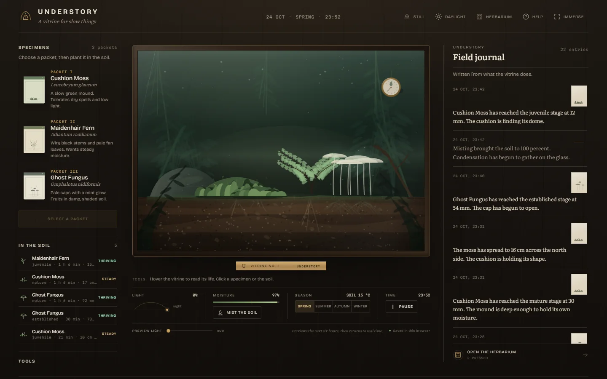
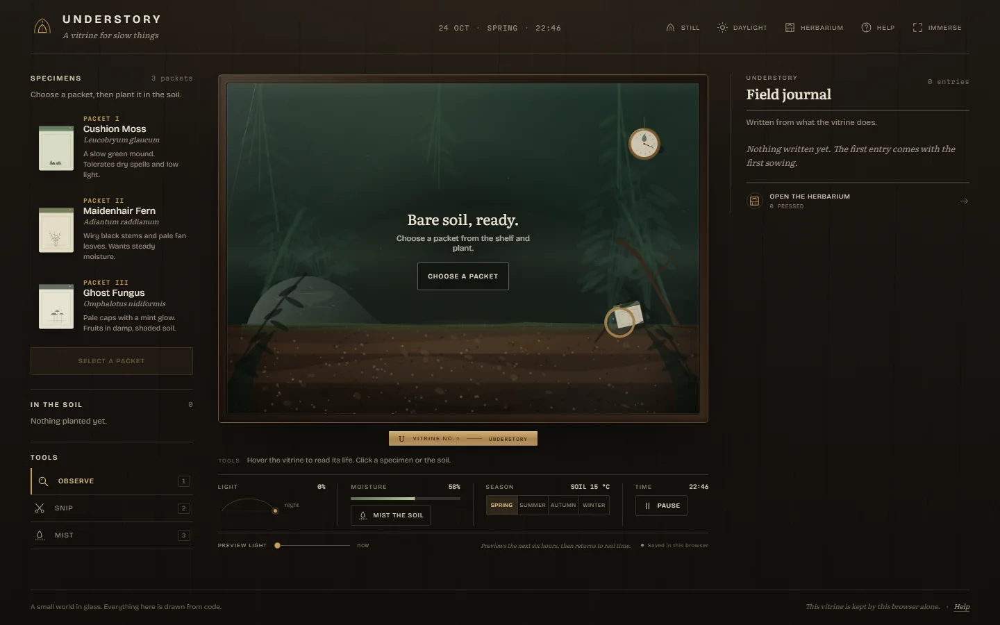
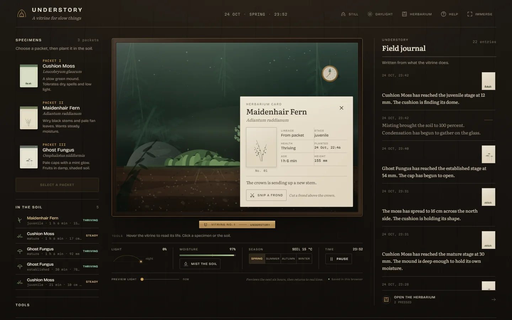
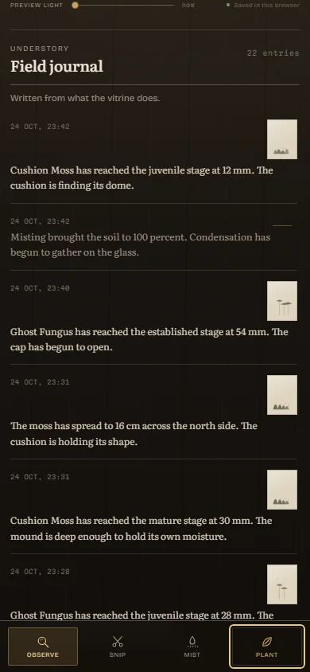
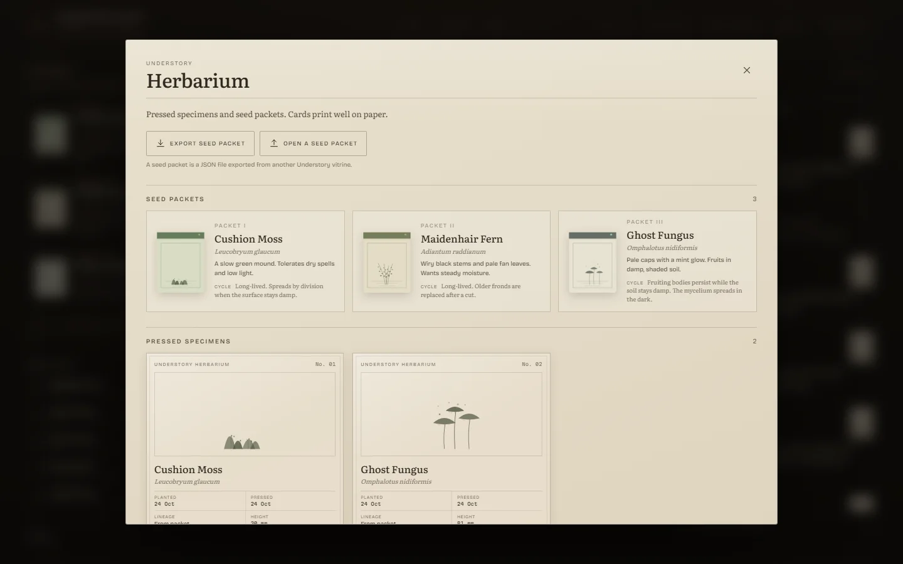
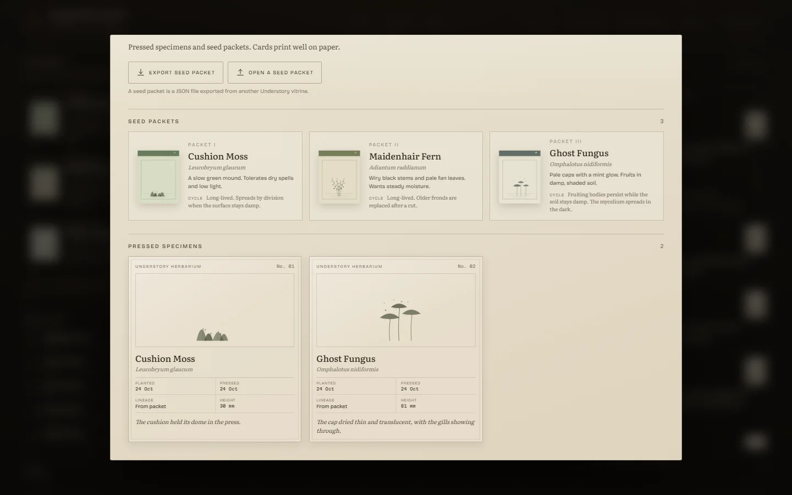
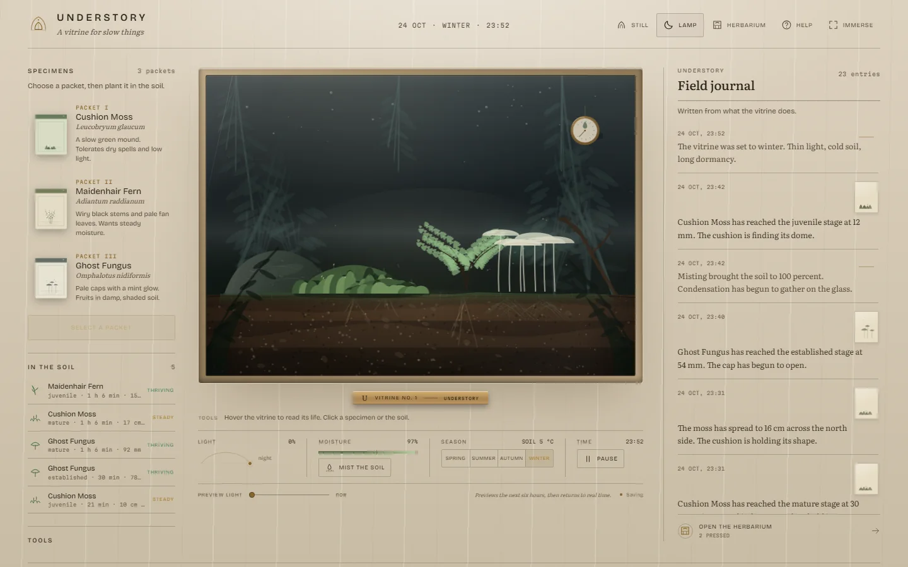
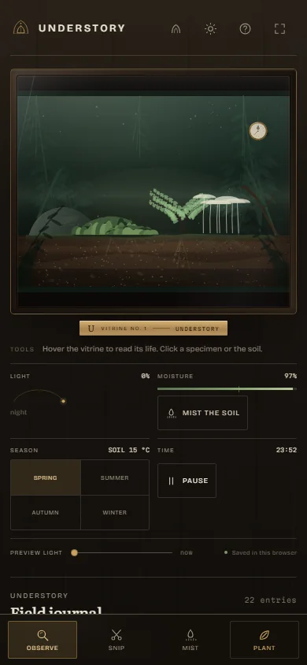
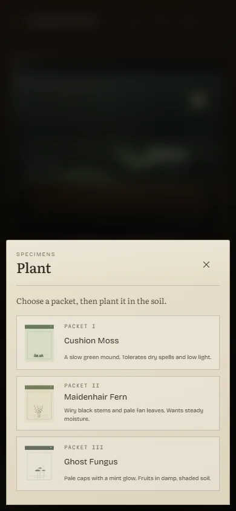

<h1 align="center">Understory</h1>

<p align="center">A living browser terrarium: a slow micro-forest of moss, fern and ghost fungus that you plant, tend and return to.</p>

<p align="center">
  <a href="https://understory-vert.vercel.app"><strong>Open the vitrine</strong></a>
  ·
  <a href="https://github.com/devtechedge/understory/releases/tag/v1.0.0">Release 1.0.0</a>
  ·
  <a href="SECURITY.md">Security</a>
</p>

<p align="center">
  <a href="https://github.com/devtechedge/understory/actions/workflows/ci.yml"></a>
  <a href="https://understory-vert.vercel.app"></a>
  <a href="#testing"></a>
  <a href="LICENSE"></a>
</p>



## What it is

Understory is one small glass case on a dark walnut workbench. You choose a
seed packet, plant it in the soil, and watch a deterministic simulation grow
in real time. Moss widens into cushions. A maidenhair fern unfurls croziers.
Ghost fungus opens pale caps after damp, dark hours.

The world keeps running while the tab is closed and catches up when you
return. Care is a balance of light, moisture and season. Cut a mature frond
and it can become a new plant. Let a specimen mature and it is pressed into
the herbarium, with a card that prints well on paper.

Everything is drawn in Canvas 2D and typeset with self-hosted fonts. There are
no accounts, no analytics, no backend and no requests after the page loads.

## The three species

| Species | Latin name | Habit | Care |
| --- | --- | --- | --- |
| Cushion Moss | *Leucobryum glaucum* | A slow green mound that widens into a carpet and can divide into a second patch. | Tolerates dry spells and low light. Keep the surface damp to encourage spread. |
| Maidenhair Fern | *Adiantum raddianum* | Wiry black stems and pale fan leaves. New croziers take longer as the plant matures. | Wants steady moisture and indirect light. A cut frond becomes a cutting. |
| Ghost Fungus | *Omphalotus nidiformis* | Pale caps with a mint glow. The mycelium spreads in the dark and fruits after damp nights. | Wants damp, shaded soil. Mature fruiting bodies release spores. |

## How care works

- **Light** follows the hour and the season. The room lamp is warm; the
  daylight theme changes the room, not the light inside the case.
- **Moisture** falls over time and rises when you mist. Dry soil slows growth
  and can push a specimen into dormancy. Care brings it back.
- **Seasons** turn every seven days and change daylight length, temperature
  and the palette. Winter is slow and dim. Summer is long and bright.
- **Pruning** a mature fern can leave a cutting in the vial. Plant it in a
  free spot to grow a new specimen.
- **Returning** after time away triggers offline catch-up, capped at two
  hours, followed by a journal entry that says what changed.

## Controls

| Action | Keyboard | Pointer |
| --- | --- | --- |
| Inspect, snip or mist | `1`, `2`, `3` | Choose a tool in the shelf |
| Read a specimen or the soil | `ArrowRight`, `ArrowLeft`, `Enter` on the vitrine | Click a plant or the soil |
| Move a seed packet | Tab to the packet, then press its plant button | Drag a packet onto the case |
| Pause or resume | `Space` | Pause in the climate strip |
| Open the journal | `J` | Scroll to the journal |
| Immerse | `I` | Immerse in the masthead |
| Help | `?` | Help in the masthead |
| Close a dialog or leave immersion | `Escape` | Close button |

Still mode removes ambient motion. It turns on automatically when the browser
asks for reduced motion.

## A closer look

<p align="center">
  
  
</p>

<p align="center">
  
</p>

<p align="center">
  
  
</p>

<p align="center">
  
  
</p>

<p align="center">
  
  
</p>

## Run it locally

You need Node 22.

```sh
nvm use
npm ci
npm run dev
```

The development server runs at http://127.0.0.1:5220. For the production
bundle:

```sh
npm run build
npm run preview
```

The preview runs at http://127.0.0.1:4187.

## Testing

```sh
npm run typecheck
npm run lint
npm test
npm run e2e
npm audit --omit=dev --audit-level=high
```

`npm test` runs 52 Vitest checks across simulation, serialisation, time,
species and preferences. `npm run e2e` builds the production bundle and runs
16 Chromium journeys at 1440x900, 390x844 and 320px, including axe-core
accessibility checks on the vitrine, help, herbarium and mobile plant sheet.

`npm run smoke` checks the live deployment, including the required security
headers. The GitHub Actions workflow splits quality, browser and audit jobs,
and CodeQL and dependency review guard changes. A daily production smoke job
opens the live site and fails on console errors, external requests or missing
headers.

## Architecture

| Layer | Responsibility |
| --- | --- |
| `src/sim/` | Pure deterministic simulation: seeded PRNG, growth, care, dormancy, seasons, pruning, cuttings, spores, journal and seed packets. |
| `src/persist/` | IndexedDB primary storage, localStorage fallback, validation and offline catch-up. |
| `src/state/` | React controller for boot, ticks, saving, preferences and the test hook. |
| `src/render/` | Canvas 2D renderer: cached backdrop and soil, three species, weather, loupe, mint particles and vignette. |
| `src/components/` | React shell, climate strip, specimen shelf, cards, journal, herbarium and dialogs. |
| `src/content/` | All public copy in one place. |

The simulation advances in 10 second ticks, caps offline catch-up at two
hours, and uses structured cloning so every care action produces a new world.
State is saved every 10 seconds and on page hide. The seed packet is a version
1 JSON envelope with bounded parsing: size, schema, numeric clamping,
identifier sanitising, control-character stripping and collection caps.

## Persistence and privacy

The vitrine lives in this browser profile. IndexedDB is used first, with a
localStorage fallback when IndexedDB is unavailable. The app checks for changes
and catches up after a long gap. A seed packet is the only way to move a world
between browsers, and you choose when to export or import it.

Seed packets contain the world, specimens, cuttings, pressed records, journal
entries and simulation counters. They do not contain account details or
personal data. Import is local: no upload, no server, no third party. Read
[SECURITY.md](SECURITY.md) for the threat model.

## Verification

Measured on 24 October 2026 against the live deployment at
https://understory-vert.vercel.app.

- Production Lighthouse desktop: 100 performance, 100 accessibility,
  100 best practices, 100 SEO. LCP 0.4s, TBT 0ms, CLS 0.001.
- Production Lighthouse mobile, median of three runs: 98 performance,
  100 accessibility, 100 best practices, 100 SEO. LCP 2.0s, TBT 20ms,
  CLS 0.
- 52 unit tests and 16 browser journeys passing. Axe reports zero serious or
  critical findings on the four checked surfaces.
- `npm audit --omit=dev`: zero vulnerabilities.
- Production build: 100.8 KB JavaScript gzipped, 9.3 KB CSS gzipped, with
  three self-hosted Latin variable font subsets.
- Security headers live on Vercel: CSP, HSTS, nosniff, frame denial, referrer
  policy, permissions policy and cross-origin isolation headers.
- Vercel auto-deploy is git-connected. Every push to `main` creates a
  production deployment, and the live alias serves the latest commit.

CI status is the badge above. Workflow runs are public.

## Limits

- One vitrine per browser profile. There is no cloud sync.
- Seed packets are version 1. Older or unknown versions are rejected.
- The renderer targets 55fps on desktop and caps compact screens at 30fps.
  It uses Canvas 2D, not WebGL.
- There is no audio, no accounts and no social layer.
- The herbarium and journal are local; clearing site data clears them.

## Licence and credits

Code, interface and original artwork are MIT licensed. See [LICENSE](LICENSE)
and [LICENSES.md](LICENSES.md).

Bricolage Grotesque, Literata and Martian Mono are self-hosted through
Fontsource under the SIL Open Font License. React is MIT licensed. Build tools
are development dependencies only.

Bug reports and careful ideas are welcome through the issue templates. Read
[CONTRIBUTING.md](CONTRIBUTING.md) before opening a pull request.
